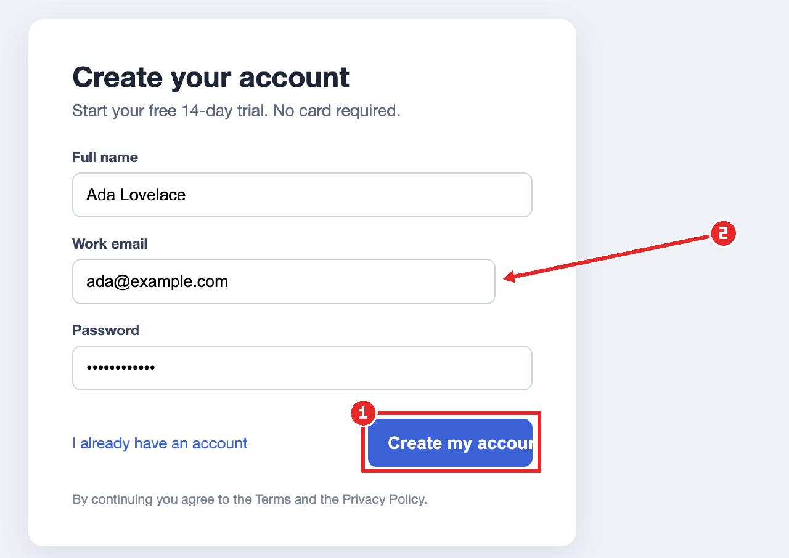
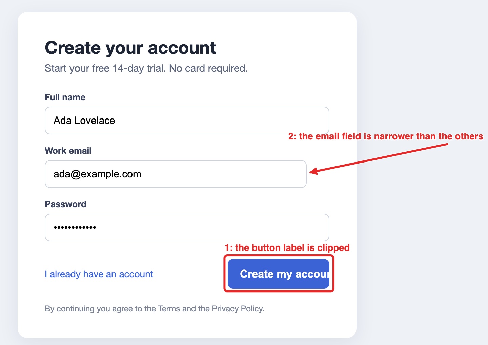

# inline-images

A mod for [Claude Code](https://claude.com/claude-code) that lets Claude **show you pictures inside the conversation**: a screenshot of a web UI, a frame from a video, a diagram. It can crop to the part that matters and draw boxes and arrows on it, so when Claude says "this button", you see which one.



Every picture also comes with a `file://` link to an SVG copy, with the labels as real text. That copy opens in any IDE or browser, so it works even in terminals that can't draw images.



## Install

At the prompt of a Claude Code terminal session:

```
/plugin install inline-images --marketplace nicolopignatelli/claude-code-inline-images
```

Answer `y` to add the marketplace, then press Enter to install at the user scope. The mod is active right away, with no restart, and in every session you start after that.

From a shell instead:

```
claude plugin install inline-images --marketplace nicolopignatelli/claude-code-inline-images
```

In the Claude desktop app, where `/plugin` does not run: click **+** next to the prompt box, then **Plugins**, **Add marketplace** with `nicolopignatelli/claude-code-inline-images`, then **Add plugin**.

**There is nothing else to set up.** The mod has no dependencies: no ImageMagick, no ffmpeg, no npm packages, nothing to install on your machine. PNG decoding and encoding, cropping and drawing all run inside the mod, in plain JavaScript, with [fflate](https://github.com/101arrowz/fflate) bundled for compression. It works the same on macOS, Linux and Windows.

## Using it

You don't call it yourself. The mod gives Claude a tool, `show`, and Claude uses it whenever it wants you to look at an image: a whole screenshot, an asset it made, or a crop with the detail it means marked on it. You can also ask for it directly:

- "Take a screenshot of the checkout page and show me what's misaligned."
- "Crop to the header and point at the logo you mean."
- "Pull the frame at 0:42 from `demo.mp4` and show me the glitch."

For video, Claude extracts the frame first with ffmpeg if your machine has it. The mod itself only ever reads PNG files.

See [examples/](examples/README.md) for a full walk-through, including the exact tool call Claude makes.

## Where the picture shows

| Where you run Claude Code | What you see |
|---|---|
| A terminal with the kitty graphics protocol (kitty, Ghostty) | The annotated picture inline, then the caption, the numbered labels and the `file://` link |
| Any other terminal, such as Terminal.app or the JetBrains terminal | The caption, the numbered labels and the `file://` link to the SVG. In the JetBrains terminal, the link is clickable and opens the SVG in the IDE |
| The desktop app, or any other remote surface | The caption, the labels and the SVG's path as text, ready to copy |

Claude Code draws inline pictures only with the kitty graphics protocol. That's a limit of Claude Code, not of this mod. tmux blocks it, too.

## How Claude points at things

- **Positions are fractions of the original image**: x from 0 (left edge) to 1 (right edge), y from 0 (top) to 1 (bottom). Claude Code shrinks large images before Claude sees them, so pixel positions would drift. Fractions mean the same thing at any size.
- **A box** is a top-left corner plus a width and a height.
- **An arrow** goes from `from` to `to`. Its tip is on the thing Claude means.
- **A label** numbers the shape. The inline picture shows the number in a marker, and the caption lists the labels by number. The SVG draws the label text beside the shape.
- **A crop** shows just part of the image, also in fractions of the original.

The tool's full input:

```json
{
  "path": "screenshots/signup.png",
  "crop": { "x": 0.27, "y": 0.15, "width": 0.6, "height": 0.67 },
  "annotations": [
    { "kind": "box", "x": 0.546, "y": 0.646, "width": 0.134, "height": 0.07, "label": "the button label is clipped" },
    { "kind": "arrow", "from": { "x": 0.82, "y": 0.43 }, "to": { "x": 0.652, "y": 0.485 }, "label": "the email field is narrower than the others" }
  ],
  "caption": "Two layout bugs on the sign-up form"
}
```

Only `path` is required.

## What it writes

Each picture writes three files to `claude-inline-images/` in your system's temp folder (`$TMPDIR` or `%TEMP%`), named after the tool call:

- `<call>.svg`: the shareable copy, with the original image embedded and the annotations as vectors and text;
- `<call>.png.b64`: the inline picture, which the transcript draws again when you scroll back or resume the session;
- `<call>.json`: the caption and labels for the transcript row.

Nothing is sent anywhere. Your operating system clears its temp folder on its own schedule.

## Limits

- **PNG only**: 8-bit and non-interlaced, which covers browser and OS screenshots. For any other file, the tool tells Claude to convert it to PNG first.
- **Files up to 4 MiB**, which is the most a mod can read at once. A Retina screenshot is usually 1 to 3 MB.
- **SVG label placement** estimates text width, since there are no font metrics. Long labels in very wide scripts, such as Chinese or Japanese, can still run past the edge.
- **The mod API is early access.** This version was tested with Claude Code 2.1.304, and the API may change between releases.

## Development

```
git clone https://github.com/nicolopignatelli/claude-code-inline-images
cd claude-code-inline-images
claude --plugin-dir .          # a session with the mod loaded from this folder; edits reload it
claude plugin test .           # the tests in test/, run in Claude Code's mod runtime
claude plugin validate .       # what Claude Code reads from the manifest and hooks
```

Once a session has loaded the mod, Claude Code writes its type declarations to `.claude-plugin/types/`, and `tsc -p .` type-checks the mod against them.

The code:

| File | What it does |
|---|---|
| `hooks/register.tsx` | Registers the `show` tool, handles calls to it, and draws its row in the transcript |
| `hooks/png.ts` | PNG decode and encode, crop, and shrink by area averaging |
| `hooks/geometry.ts` | Maps fractions of the original image into the pixels of each drawing |
| `hooks/raster.ts` | Draws boxes, arrows and numbered markers into the inline picture |
| `hooks/svg.ts` | Builds the shareable SVG |
| `hooks/lib/fflate.js` | [fflate](https://github.com/101arrowz/fflate) 0.8.2, unmodified (MIT, see `hooks/lib/fflate.LICENSE`) |

## License

MIT, see [LICENSE](LICENSE). Bundles fflate 0.8.2 by Arjun Barrett, also MIT.
